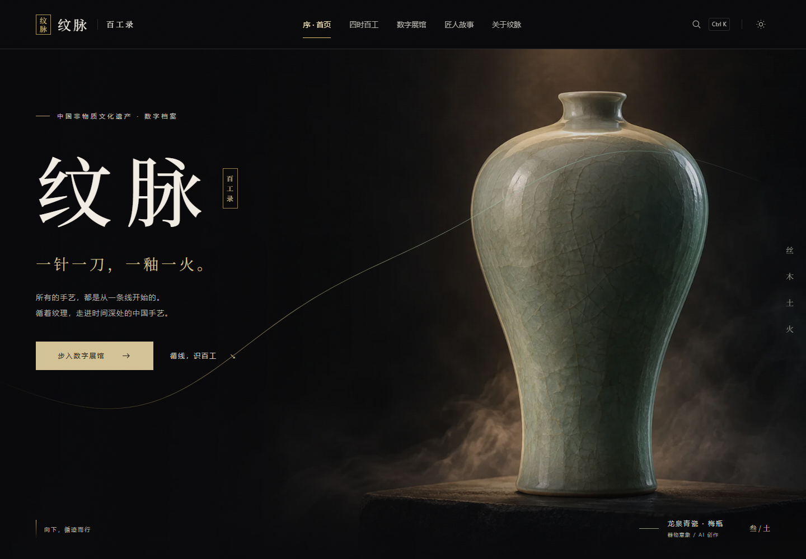

<!-- 说明作品运行、设计、依赖、素材与参赛前所需资料。 -->
# 纹脉 · 百工录

所有的手艺，都是从一条线开始的。



面向武汉大学 2026「零杯」主题二「匠心传成，非遗焕新」的数字非遗档案馆。以苏绣、东阳木雕、龙泉青瓷、景泰蓝四章，连接一针、一刀、一釉、一火。原生多页面，手写 CSS，无预设样式库，无后端。

## 直接运行

安装 Node.js 后，双击根目录 `启动预览.cmd`，或运行：

```sh
node scripts/serve.mjs
```

浏览器访问 `http://127.0.0.1:4173`。如果端口已占用，可设置 `PORT` 环境变量。请使用 HTTP 服务浏览；直接双击 HTML 的 `file://` 方式不能可靠加载 ES Modules。

`dist/` 是独立的静态部署目录，已含全部本地图片、字体和三维库。部署时将其内容作为网站根目录，不依赖 CDN、在线图片或在线字体服务。

## 页面与功能

| 页面 | 内容 |
|---|---|
| index.html | 青瓷暗场、滚动变形叙事线、错位四章入口 |
| gallery.html | 四种程序化车削器物、五种釉色、惯性旋转、缩放、线框、复位 |
| craft/embroidery.html | 平针、乱针、打籽的绘制示意，拖动或按键落针 |
| craft/carving.html | 局部擦除木层，显露莲花雕纹，按钮与拖动走刀 |
| craft/celadon.html | 模拟窑温与釉色、开片同步变化 |
| craft/cloisonne.html | 曲线吸附掐丝、花瓣点蓝、七瓣完成检测 |
| stories.html | 四位匠人的资料片段、材料筛选、故事抽屉与出处 |
| about.html | 作品说明、技术、文献、素材来源、收藏与阅读进度 |

全站支持 Ctrl / ⌘ K 检索、上下键选择、Enter 跳转、Esc 关闭；墨夜与宣纸主题可记忆。收藏和观展进度仅保存在本机浏览器 localStorage，可在关于页移除收藏，不上传服务器。浏览器禁止存储时会提示无法保存。

## 原创技术与视觉

- SVG 叙事线使用五组等点数路径与逐点插值；动画共用单一帧调度器，后台暂停。
- `LatheGeometry` 将原创半径—高度控制点车削成器物，不下载模型、不引入 HDRI。
- 自写釉面 shader：菲涅尔提亮、层叠噪声、胞元边缘开片与风格化兔毫/曜变。
- 手写阻尼控制器，支持指针、滚轮与键盘，不使用 OrbitControls。
- 原生 Web Components、原生 dialog、跨页面 View Transitions、语义化静态正文。
- 墨底、铜金与釉青、宋体标题、系统黑体正文、克制的毛玻璃和纸感噪点。

## 第三方库及工具

| 名称 | 版本 / 许可 | 用途与使用理由 | 是否随页面运行 |
|---|---|---|---|
| three.js | 0.170.0 / MIT | WebGL 与程序化车削几何，用于器形研究；本地 vendoring，展馆按需加载 | 是 |
| esbuild | 0.25.0 / MIT | 仅压缩打包三维库，避免引入运行时构建工具 | 否 |
| Sharp | 0.33.5 / Apache-2.0 | 将生成图压缩成两档 WebP，控制首屏体积 | 否 |
| Playwright | 1.51.1 / Apache-2.0 | 驱动本机 Chrome 验证四档布局、交互和降级 | 否 |
| FontTools | 4.67.0 / MIT | 在本地对子集字体裁剪；不向外发送页面文字 | 否 |
| Brotli | 1.2.0 / MIT | 为字体生成 WOFF2 压缩 | 否 |

three.js 许可保存在 `vendor/three/LICENSE`。字体许可保存在 `assets/fonts/OFL.txt`。本地开发依赖声明在 package.json 和 package-lock.json；工具不加入静态部署目录。

## 开发与验收

```sh
npm install
npm run build
npm run check
npm start
# 在另一个终端执行
npm test
npm run package
```

`build` 从 `src/content/` 生成八页 HTML，再同步静态部署目录。已随附构建结果，运行成品不需要安装上述开发依赖。

浏览器验收默认使用 Windows 标准位置的本机 Chrome。其他设备可设置 `WENMAI_CHROME` 指定可执行文件，`WENMAI_URL` 指定预览地址。报告保存在 `reports/static-check.json` 与 `reports/browser-check.json`，桌面与移动截图也在 `reports/`。

重做字体时先安装 FontTools 与 Brotli，然后运行 `scripts/subset-fonts.ps1`。可用 `WENMAI_PYTHON` 指定 Python；原始公开字体放在 `.tooling/fonts/NotoSerifSC.ttf`，由脚本下载。只有公开字体文件会被下载，页面文字仅在本地读取和处理。已有 WOFF2 不需要重新生成。

## 适配与降级

| 情况 | 行为 |
|---|---|
| 1920 / 1440 / 720 / 375 宽度 | 独立响应式布局；移动端底部导航、工序改纵向 |
| 小于 900px | 展馆不加载 three.js，提供二维器形切换与翻面笔记 |
| WebGL 不可用或上下文丢失 | 切换二维卡片，保留器形、釉色、转向与复位；隐藏线框、速度等专属三维控件 |
| 2G / 3G / saveData | 不加载三维库；改用系统宋体以避免下载字体；停止线条变形 |
| 减少动态效果 | 停止自动旋转、路径变形和磁吸随动，保留用户主动操作 |
| 键盘 | 焦点环、跳至正文、弹窗焦点管理；体验区按钮替代手势 |

展馆图片中的釉色、窑温滑块和 shader 均为数字艺术示意，不能预测真实烧成结果。建盏形制与自由釉色选择也不构成历史器物配对。

## 素材版权与 AI 使用

首页图片由 OpenAI 内置 imagegen 生成，已明确标注为“器物意象 / AI 创作”，非真实馆藏照片。工具、完整提示词、源图与输出见 `docs/IMAGE_PROMPT.md` 与 `DESIGN.md`。其余纹样、木纹、器形图、剪影、印章为原创 SVG / Canvas；无第三方文物照片，无下载三维模型。

Noto Serif SC 原始字体来自 Google Fonts 官方仓库，依据 SIL OFL 1.1 在本地裁剪，不转载未经许可的系统字体。正文使用系统字体，不打包字体文件。历史资料以官方文化机构公开文章为依据，页面附来源，全部归纳改写，不冒充人物访谈原话。

## 团队与提交

队伍名、组别、队长及成员姓名、学院、学号均未由用户提供，当前版本不代填身份信息。AI 辅助完成设计、代码与标明的图片生成。

交付目录目前包含“完整预览版”“匿名预览版”与嵌套的总包，用于检查与本地演示；它们尚未使用赛事要求的身份命名。正式包装命令支持：

```sh
node scripts/package.mjs --group 零杯零组 --team 实际队伍名 --leader 实际队长姓名
```

先在 `docs/team.json` 填写本人确认的信息，再使用对应组别打包。完整版附队伍信息，匿名版移除队伍文件和完整 README 中的身份信息。预览包和正式包均不包含 `.git`、`node_modules`、工具缓存、原始比赛施工文档和浏览器报告。

## 已知验证范围

已执行的自动结果以 JSON 报告为准，不作主观赛事评分。使用当前安装的 Chrome，未以真实 Chrome 129 和参赛电脑集显完成复核；慢网是浏览器网络模拟，不等于所有真实移动网络。文物材质和技艺体验为艺术演示，无教学认证。正式提交仍需补充队伍身份并核对主办方最新规则及截止时间。
